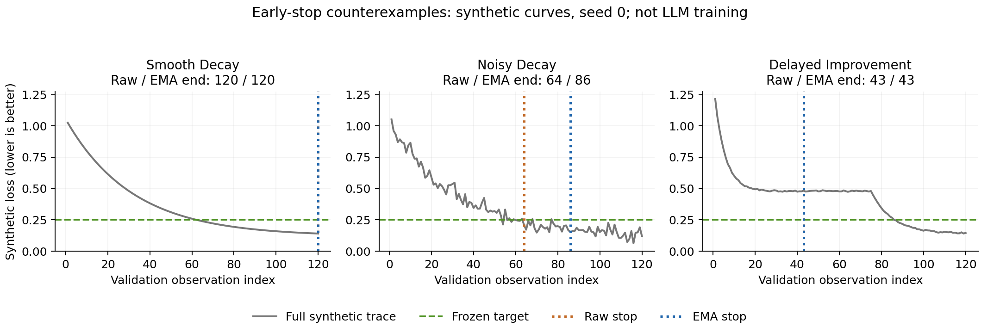

# 训练早停策略复盘：一晚可讲清的教学仿真

**所有曲线均为人为合成；没有训练 LLM，没有测 GPU 性能，也没有复现或推断 EcoTrain 的内部算法。** 这个小项目回答一个范围很窄的问题：一个策略少执行了多少次验证评估，以及它是否同时错过了预先设定的质量目标。

## 如何运行

仅依赖 Python 标准库。PowerShell：

```powershell
& 'E:\my_evns\py312_torch28\python.exe' 'C:\Users\ROG\Documents\八股\ecophase_prep_20261020\early_stop_replay.py'
```

程序固定生成 `results_early_stop.json` 和 `results_early_stop.csv`，重跑会覆盖这两个派生结果文件。JSON 包含协议、汇总、每次运行结果和每类 seed=0 的完整示例曲线；CSV 包含 270 条策略运行记录。

## 在第一次运行前冻结的协议

| 项目 | 固定设置 |
|---|---|
| 完整评估预算 | 每条曲线 120 次 evaluation |
| 重复次数 | 每类 seed=0..29，共 30 个 seed |
| 质量目标 | 最低已观察 loss ≤ 0.25 |
| patience | 10 次连续没有显著改善的 evaluation |
| min_delta | 0.005，使用严格小于 `历史监控最优值 - min_delta` 判断改善 |
| EMA alpha | 0.25；首个值初始化 EMA |
| checkpoint | 停止前（含停止当次）原始观测 loss 最低的 checkpoint |
| 策略 | fixed budget、raw patience、EMA patience |

这里的 **evaluation 是一次验证指标观测，不是训练 step、epoch、秒、GPU-hour 或耗电量**。真实训练每两次评估之间可能做许多训练 step，评估自身也有成本，所以不能直接把本例节省比例解释成 GPU 成本降幅。

三类曲线的设计：

1. `smooth_decay`：`0.12 + amplitude × exp(-evaluation / decay_scale)`；每个 seed 的 amplitude 从 [0.85, 0.95] 采样，decay_scale 从 [27, 33] 采样。
2. `noisy_decay`：同一形式，加标准差 0.035 的独立高斯噪声。
3. `delayed_improvement`：前 25 次快速降到约 0.48，第 26–75 次平台，第 76 次后再次下降到约 0.14；加标准差 0.003 的噪声。**这是预先人为构造的误停反例，不代表真实训练中这种现象的发生频率。**

seed 使用 `curve_type_index × 10000 + seed` 初始化。所有 loss 截断到至少 0.001。各策略使用完全相同的曲线，决策函数只能看到尚未停止的历史前缀；EMA 仅用于触发停止，checkpoint 和质量验收仍使用原始观测值。

## 指标怎样读

- **Target attainment**：停止时保留的最好 checkpoint 是否达到了固定目标。
- **Saved evaluation fraction**：`1 - stop_evaluation / 120`。它只表示少做的评估次数比例。
- **Evaluations to target**：首次观察到 loss ≤ 0.25 的评估编号；未达到目标时 JSON 为 `null`，CSV 为字面量 `null`。不把失败伪装成 0 或 120。
- **False stop**：该策略提前停止且未达目标，但同一条完整未来曲线能够达标。这个定义仅用于事后复盘，真实线上策略不能偷看未来。

固定预算即使早已达标也执行到第 120 次。它不是最优策略，而是给所有策略提供共同观察上限与完整反事实轨迹。项目没有加入“知道未来何时达标就恰好停止”的 oracle。

**不要单报节省比例并称成功。** 应并列报告达标率、误停率和节省评估次数。只在达标子集上报告首次达标的平均评估次数也存在选择偏差，必须同时给出达标数；程序已这样输出。三类曲线是人为均衡设置，不能混合后声称代表真实训练工作负载。

本例的质量验收和 checkpoint 选择共用同一条模拟验证曲线。真实实验需要另设未参与停止/调参/选 checkpoint 的保留测试集，避免反复查看验证集和选择最低噪声值带来的乐观偏差。当前脚本没有模拟独立测试集，因此不声称验证了泛化质量。

## 三个实际自检

1. 所有 fixed-budget 策略必须执行完整预算，节省率为零，且不发生提前误停。
2. 人为设计的 delayed-improvement 轨迹中，至少一种 patience 策略必须出现误停，而完整预算能够达标。
3. 真正未达标的运行，其首次达标次数必须是 `null`；已达标运行的次数必须在所观察前缀内。

三个检查在每次正常执行时运行。它们检查测量定义与反例是否真的成立，不证明某策略在现实中优于另一策略。

## 本次固定协议的实测输出

下表来自脚本首次运行，运行后没有调整曲线或策略参数：

| 合成曲线 | 策略 | 达标数 | 平均节省评估次数 | 误停数 |
|---|---|---:|---:|---:|
| 平滑下降 | fixed budget | 30/30 | 0.0% | 0/30 |
| 平滑下降 | raw patience | 30/30 | 0.0% | 0/30 |
| 平滑下降 | EMA patience | 30/30 | 0.0% | 0/30 |
| 噪声下降 | fixed budget | 30/30 | 0.0% | 0/30 |
| 噪声下降 | raw patience | 28/30 | 38.6% | 2/30 |
| 噪声下降 | EMA patience | 30/30 | 20.9% | 0/30 |
| 平台后再改善 | fixed budget | 30/30 | 0.0% | 0/30 |
| 平台后再改善 | raw patience | 0/30 | 68.0% | 30/30 |
| 平台后再改善 | EMA patience | 0/30 | 64.8% | 30/30 |

这个结果支持的结论很有限：在本次人为定义的噪声曲线上，EMA 比 raw patience 少误停，但保留了更多评估；两个 patience 策略都被预设的长平台反例欺骗。**68.0% 的“节省”同时对应 0/30 达标，不能称为成功的加速。**

## 明天怎样准确介绍



> 我昨晚做了一个很小的合成曲线回放，没把它当成真实训练加速结果。我想先把验收标准想明白：节省次数必须和目标质量达标率一起看。在我故意构造的长平台后继续改善的反例中，patience 会错过后面的进展。下一步如果有真实训练日志，我想冻结目标和规则，再做多 seed 回放，并用独立保留集确认 checkpoint 的质量。

如果被问“EMA 能解决误停吗”，准确答案是：它可能缓解短期噪声，但不能从历史平台中知道未来必然还会改善；这个演示不预设 EMA 一定更好。

## 与公司公开产品的连接

截至 2026-10-20 读取的 [EcoTrain 文档](https://ecophase-ai.com/docs/product-introduction/ecotrain)将产品描述为收敛加速；[EcoTrain Pro 文档](https://ecophase-ai.com/docs/product-introduction/ecotrain-pro)增加早停和节省卡时统计。[数据边界文档](https://ecophase-ai.com/docs/privacy-security/data-boundaries)提及 loss、学习率和梯度状态等必要运行信息。这只是选题背景，不表示本脚本采用了他们的算法。

适合问的问题是：“团队如何在同等目标质量下区分每步加速、减少训练步数与早停的贡献？我能否从评测和误停分析模块开始？”不需要假装自己已掌握其内部算法。
