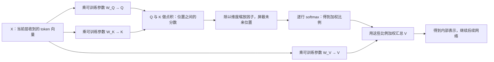
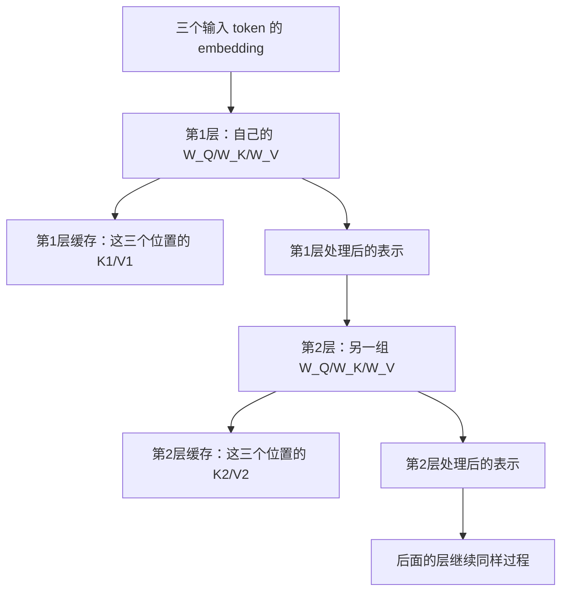

# 基础逐项解释：从输入和参数，到缓存、服务和 Git

2026-10-21。对应原基础地图第 1、4–10 节。数学例子为便于理解而人为设定，不是从真实模型提取的权重。

先分清：**模型**是学习到的计算规则与参数；**框架**负责把模型运行和服务起来；**优化技术**改善某个计算环节；**指标**描述运行表现。这四类东西不能按“哪个新模型替代哪个旧模型”理解。

## 1. X、x、QKV、qkv 到底是什么

以下先只讲一层、一个 attention head、一个请求，暂时略去位置编码、bias、归一化和多头拼接。

### 输入 X 是若干 token 的向量排在一起

假设文本被分成两个 token，每个 token 用两个数表示：

```text
x₁ = [1, 0]
x₂ = [0, 1]

X = [1, 0]    ← 第 1 行就是 x₁
    [0, 1]    ← 第 2 行就是 x₂
```

这里：

- `x_i` 是第 i 个 token 进入当前这一层时的表示向量。
- `X` 是把所有位置的 `x_i` 按行排起来的矩阵。
- 第一层的表示来自 token embedding；后面的层收到的是上一层处理后的表示，也叫 hidden states。
- 实际模型还会有归一化和位置处理；例如 RoPE 会旋转 Q/K，不能把所有模型都理解成“直接给 X 加一个位置向量”。

**X 是输入数据在这一层的表示，不是一张固定权重表。** 同一个 token 在不同层的表示通常不同，在不同前文中也可能不同。

### 模型有三组可学习的投影参数

它们叫 `W_Q、W_K、W_V`。一组输入，通过三套不同的线性变换，分别变成 Q、K、V：

```text
Q = X × W_Q          q_i = x_i × W_Q
K = X × W_K          k_i = x_i × W_K
V = X × W_V          v_i = x_i × W_V
```

大写表示所有位置的集合；小写表示其中一个位置。**小 q 不需要再通过某个额外算法从大 Q 生成，它就是 Q 的一行。**

语义上可以把 q 想成“我要查询什么”，k 想成“供匹配的特征”，v 想成“匹配后要汇总的信息”；这些是方便理解的比喻，实际都是数字向量。



图中不是三个独立大模型，也不是去外部数据库取三个字段。都是同一个模型层内部的计算。

### 哪些是参数，哪些是临时结果

| 东西 | 是什么 | 通常是否由优化器直接更新 |
|---|---|---|
| 用户文本、token IDs | 这次提供的数据 | 否 |
| Embedding 查找表 E | 每个 token 对应向量的参数表 | 全参数训练时通常是 |
| 查表得到的向量、X | 当前数据的表示 | 否；训练时可能通过它传递梯度 |
| W_Q、W_K、W_V | 生成 Q/K/V 的规则 | 全参数训练时通常是 |
| q/k/v、Q/K/V | 规则作用于输入后算出的结果 | 否 |
| Attention 的 softmax 比例 | 当前输入下临时算出的关注程度 | 否 |
| 输出投影、MLP、最终词表投影等权重 | 网络其它计算规则 | 全参数训练时通常是 |
| KV cache | 保存下来的 K/V 计算结果 | 否 |
| 层数、头数、每头维度 | 设计/配置 | 不靠普通梯度下降学习 |

**训练时会对中间结果求梯度，不等于把它当成独立参数更新。** 例如 X 来自可训练的 embedding 表，梯度可以经过 X 回到表中，但优化器维护的是参数表，而不是每个请求独立的一份 X。

“固定”也要说清楚：推理时 W 通常固定，但每个请求的 X/Q/K/V 会随输入变化。LoRA 或冻结部分网络时，哪些参数更新由训练方案决定。输入 token 数、并发数是运行配置/数据形状，不是永远不变的常数。

从头训练时，许多权重先按初始化规则赋值，再通过“预测→算损失→反向传播→优化器更新”逐渐学到；加载预训练模型时，读取的就是已经学好的参数。`sqrt(head_dim)` 中的 head_dim 是结构配置，缩放因子不是需要学习的权重。因果 mask 由位置关系构造，也不是训练出来的一张参数表。

Attention weights 有时指 softmax 后的加权比例；这里的 weights 不等于 W_Q 这种可训练模型权重。

### 用两个 token 手算一次

假设：

```text
X = [[1,0], [0,1]]
W_Q = W_K = [[1,0], [0,1]]
W_V = [[1,2], [3,4]]
```

这里的参数是我们人为选的；真实训练中由训练过程学到。

| 位置 | x | q | k | v |
|---|---|---|---|---|
| 1 | [1,0] | [1,0] | [1,0] | [1,2] |
| 2 | [0,1] | [0,1] | [0,1] | [3,4] |

第 2 个位置用自己的 q₂ 给两个 k 打分：

```text
q₂·k₁ = 0
q₂·k₂ = 1
除以 sqrt(2) 后：[0, 0.7071]
softmax 后约为：[0.3302, 0.6698]
```

所以第 2 个位置取出的信息是：

```text
0.3302 × [1,2] + 0.6698 × [3,4]
≈ [2.3395, 3.3395]
```

这就是“注意力”：给可见位置分配不同权重，再汇总那些位置提供的信息。这个向量还不是输出的字，也不是最终词表 logits。

## 4. Prefill、logits、因果结构和逐层缓存

### Logits 是分数向量；不要直接叫它 embedding

你说它是“一组尚未归一化的分数”是对的。

Embedding/hidden state 主要用来表示 token 的内部特征；最终词表 logits 则给每一个候选 token 一个分数。两者都可以是向量，区别在含义，而非是否归一化——embedding 本身也不保证归一化。

假设词表只有四个候选：

| 候选 token | 饭 | 面 | 水 | 结束 |
|---|---:|---:|---:|---:|
| logit | 2 | 1 | 0 | -1 |
| softmax 概率（约） | 64.4% | 23.7% | 8.7% | 3.2% |

模型可从这些概率采样，也可选分数最高的 token。因此 logits 是生成下一 token 之前的打分结果。

```text
最后一层 hidden state h
    → 乘可训练的词表投影 W_vocab
    → logits（长度 = 词表大小）
    → softmax / 采样或选取
    → 一个 token ID
```

例如 hidden state 长 4096、词表有 128000 个 token，那么对应的 logits 长 128000，不是仍然长 4096。某些模型会让输入 embedding 和输出投影共享权重，但两者输出的用途仍不同。

另一个同名用法：Attention 内部的 QK 分数也可被叫作 attention logits，它给“位置”打分；最终模型 logits 给“词表候选 token”打分。本文没有特别说明时指后者。

### Prefill：先处理你已经给出的那段输入

假设输入三个 token：“我 / 想 / 吃”，为了举例，暂且假定分词刚好如此。

1. **Prefill**：把这三个已知 token 送过整个模型，计算它们的各层表示和 K/V。最后一个位置产生的 logits 用来选第一个新 token，比如“饭”。
2. **Decode**：再把刚选出的“饭”送入模型，利用之前的 K/V 算它的表示，预测下一 token，比如“。”。
3. 再把“。”送入模型，继续预测，直到停止。

Prefill 可理解为“预先处理已有输入，并填好后续需要的状态”。它没有提前生成整段未知答案；已知输入的多个位置可以用矩阵运算一起处理，同时遵守因果限制。

**“饭”刚被选出来时，并不已经有了它自己的逐层 KV；它要在下一次送入模型时才产生这些 KV。**

### 因果结构：Causal attention / Causal masking

这里的 causal 表示**一个位置只能读取自己和更早位置的信息，不能偷看未来位置**，不是在做因果推断。

对三个位置，允许访问的关系如下：

| 谁正在查询 | “我”的 K/V | “想”的 K/V | “吃”的 K/V |
|---|---|---|---|
| “我”的 q | 可以 | 不可以 | 不可以 |
| “想”的 q | 可以 | 可以 | 不可以 |
| “吃”的 q | 可以 | 可以 | 可以 |

这是“覆盖全部允许历史位置的因果注意力”。相比之下，双向注意力可以让前面的位置读取后面的位置。

正因为旧位置不看未来，在权重、位置及已有上下文保持相同的常规推理中，追加“饭”不会改变“我/想/吃”已经算出的历史 KV。这是复用的前提。

### KV cache 的 cache 是什么，存在哪里

拼作 **cache，意思是缓存**；cash 是现金。

KV cache 是把刚才算出的 K/V 存下来，下一步直接使用。通常就是推理框架分配和管理的 GPU 张量/显存块，也有移到 CPU 等实现。**不需要再训练一个“缓存模型”，一般也不需要用户另建数据库。**

“各层历史 token 的 KV”是这样得到的：



每一层收到的表示不同、使用的参数也不同，所以各层 K/V 不是同一份。新 token 到来后，分别在每层算出自己的 k/v，并写入该层缓存。

缓存仍要被读取并参与 attention；省掉的是重新计算历史位置的那部分工作。过去的 q 通常不保存，因为下一步只需要当前新位置的 q；历史 k/v 还会被新的 q 查询。

机制与存储形式可核对 [Hugging Face 缓存文档](https://huggingface.co/docs/transformers/cache_explanation)。

### “普通全注意力/GQA 的近似 KV 占用”应怎样讲人话

上一版把两个不同维度挤在了一起，应改成：

> 对于保留全部历史 K/V 的普通多头注意力或分组查询注意力，估算要存多少数字，再算这些数字占多少字节。

- **Full/dense attention**：关注允许范围内的全部位置；这里是全部过去位置，而非只看最近一小段。
- **MHA（Multi-Head Attention）**：普通多头注意力，可以想成同时用多个投影角度查询信息；每个 Q 头有对应的 K/V 头。
- **GQA（Grouped-Query Attention）**：几个 Q 头共用一组 K/V，减少需要保存的 K/V 数量。

例如 8 个 Q 头：MHA 可对应 8 组 K/V；GQA 可让每 4 个 Q 头共享一组，总共只保存 2 组 K/V。**GQA 也可以关注全部历史，不能把“全注意力”和“GQA”当成互斥分类。**

为什么要乘起来？是在数一个多维数组里共有多少个数字：

| 逐步数 | 缓存量 |
|---|---:|
| 一个 token、一层、一个 KV 头；k 和 v 各有 2 个数 | 2 × 2 = 4 个数 |
| 两个 token | 4 × 2 = 8 个数 |
| 每个数占 2 字节 | 8 × 2 = 16 字节 |
| 两层都要保存 | 16 × 2 = 32 字节 |
| 同时两个独立请求 | 32 × 2 = 64 字节 |

因此：

`字节数 = K/V两份 × 层数 × 请求数 × 每请求已处理token数 × KV头数 × 每头数字个数 × 每个数字字节数`

这和“每层楼多少房间 × 每房间多少椅子 × 多少层楼”是同一种计数。

“近似”表示只估算 K/V 原始张量，不包含模型权重、临时结果、管理信息、内存块对齐等。请求长度不同要分别相加；共享前缀、滑窗和压缩缓存还会改变物理用量。token 数包含已处理的输入和生成部分。

## 5. Prefix caching 和 FlashAttention 各做什么，会过时吗

**Prefix caching：** 假设你连续问“同一份 20 页说明书 + 问题 A”和“同一份 20 页说明书 + 问题 B”。前面的说明书如果对应相同 token 前缀，且模型/配置允许复用，框架可以直接取第一次算好的那段 KV，只处理新的后缀；因此少做重复的 prefill。它复用中间状态，不是重复上次的回答。缓存不存在、被回收或前缀变化时，就需要重新处理。它是当前推理框架仍在使用的技术，不是某个旧语言模型。[vLLM APC 文档](https://docs.vllm.ai/en/latest/features/automatic_prefix_caching/)

**FlashAttention：** 朴素实现容易把 token 两两相关性的巨大中间表写入 GPU 显存，之后又读回来继续计算。FlashAttention 将计算分块，尽量在更快的片上存储里计算和合并，减少这种大表的显存往返。它优化 Attention 的实现，保持对应的运算语义，浮点结果不保证逐位一致；没有把 dense attention 的理论计算复杂度变成线性。它同样不是语言模型。

截至 2026-10-21，官方项目已有 FA2、FA3、FA4；当前 FA4 实现面向 Hopper 和 Blackwell，FA3 主打 Hopper。具体选择由显卡、数据类型、形状和框架后端支持决定，不能只按版本号选。基础思想仍有用，旧论文中的速度数字则不能直接替代当前测量。[FlashAttention 官方项目](https://github.com/Dao-AILab/flash-attention)

| 技术 | 复用或优化什么 | 例子 |
|---|---|---|
| 逐请求 KV cache | 同一生成过程的历史 K/V | 生成第 101 个 token 时复用前面的状态 |
| Prefix caching | 新请求与已有请求相同前缀的 KV | 同文档问不同问题 |
| FlashAttention | 一次 attention 内的数据访问和计算组织 | 分块计算，减少大中间表的显存读写 |

## 6. 吞吐不一定是输出；vLLM/SGLang 是软件框架

**吞吐（throughput）只表示单位时间处理多少工作，必须说明工作是什么。**

假设同一个完整 10 秒窗口里完成 100 个请求，共处理输入 20000 token、生成输出 5000 token：

| 指标 | 计算 | 结果 |
|---|---|---|
| 请求吞吐 | 100/10 | 10 requests/s |
| 输入吞吐 | 20000/10 | 2000 input tokens/s |
| 输出吞吐 | 5000/10 | 500 output tokens/s |
| 输入加输出吞吐 | 25000/10 | 2500 tokens/s |

这些都是同一个系统的不同统计口径。并发处理时，系统输出 500 token/s 不等于单个用户每秒看到 500 token。

延迟看单个请求等多久；吞吐看整个系统忙得过来多少。比如一辆大巴每趟能运更多人，不代表每个乘客更早到达。

| 名称 | 类别 | 通俗定位 |
|---|---|---|
| Qwen、Llama 等 | 模型家族 | 有模型结构和训练出来的参数 |
| PyTorch | 深度学习框架 | 张量运算、自动求导等基础工具 |
| vLLM、SGLang | 推理与服务框架 | 加载模型，管理请求、缓存、批处理和 GPU 执行 |
| FlashAttention | 算法及底层实现 | 更高效地算 attention |
| 吞吐、TTFT、TPOT | 指标 | 分别度量处理量、首 token 等待、后续平均生成间隔 |

vLLM/SGLang 有对应论文，但 JD 的“熟悉 vLLM/SGLang”通常指会使用和理解软件，而不是只读论文。它们仍在持续发展，当前官方资料保留了缓存、批处理和多 GPU 等功能；没有证据支持“已经过时、必须换一个更新模型”的判断。[vLLM](https://docs.vllm.ai/en/latest/)、[SGLang](https://docs.sglang.io/)

可以用 ComfyUI 类比：ComfyUI 是运行模型工作流的软件，不是里面那个图像生成模型；vLLM/SGLang 与它加载的语言模型也应分开理解。类比只为区分类别，不表示它们功能相同。

## 7. 服务框架：从“我运行一次”到“同时服务很多人”

一个 Python 脚本给你回答一次，并不自动解决同时 100 人发请求的问题：谁先算？谁在等待？显存怎样分？谁结束后腾出空间？模型输出怎样传回客户端？

**Serving 就是把模型运行包装成可以持续接受和处理请求的服务。** 框架负责其中的组织工作。

### Batch、并发、continuous batching

- 并发：同时有多少个请求在系统里处理或等待。
- Batch：某一次计算把哪些请求的数据凑在一起处理。它和并发数不必相等。
- Continuous batching：每轮计算之间可以补进新请求，移走已结束请求。

假设可同时处理 2 个请求，A 要输出 2 个 token，B 要输出 5 个，C 正在等：

```text
第1轮：A + B
第2轮：A + B，A 完成
第3轮：C + B
第4轮：C + B
```

C 的 prefill 和调度仍需实际资源，此图只是说明“空出位置就能安排新工作”，不是精确 kernel 时间线。

更多请求凑一起往往提高总吞吐，但单个用户可能等得更久。因此“吞吐高”和“体验快”要分别看。

### Chunked prefill：别让一个大输入长时间堵住正在输出的人

A 正在逐字输出，B 突然发来一本很长的文档。如果一次性处理 B 的全部输入耗时很久，A 的后续输出可能停顿。

Chunked prefill 就把 B 的输入处理切成若干块，让调度器更灵活地穿插 A 的 decode。具体怎样分块，既影响 B 等首字的时间，也影响 A 输出是否流畅，需要实测。[vLLM 调优](https://docs.vllm.ai/en/latest/configuration/optimization/)

### PagedAttention：缓存不必挤在一整段连续显存里

每个请求的输出长度事先不完全知道。若先给每个请求留一大段连续空间，容易留多了浪费、留少了不好增长。

分页缓存管理将 KV 划成较小的物理块，并记录“这个请求第几段历史放在哪一块”。请求增长时再分块供给，attention 实现按映射找到内容。它借用了内存分页的思想，重点是更灵活地管理/访问 KV；不用把它想成“把整份缓存存到硬盘”。

## 8. 计算、显存访问、通信、量化

### 显存是仓库，计算单元要不断取数

GPU 里既有存数字的地方，也有做乘加的单元。算一道矩阵乘法，先要拿到权重和输入，再执行运算，还要把结果放到合适的位置。

| 限制因素 | 发生了什么 | 直观例子 |
|---|---|---|
| 计算瓶颈 | 数据能供应，乘加等运算来不及完成 | 厨师切菜炒菜太慢 |
| 访存瓶颈 | 计算单元等着数据从显存搬过来 | 厨师快，但仓库送菜慢 |
| 通信瓶颈 | 多 GPU 之间交换数据或等待同步耗时 | 多家厨房合作，却一直等运输 |

GPU 利用率高只是一项观察，不能直接证明是哪种瓶颈。工程上要用性能分析工具看时间具体花在哪里。

### 为什么 prefill 和 decode 的表现不同

Prefill 有一整段已知输入，可以一起做较大的矩阵运算，较容易把计算资源用起来。

低并发 decode 每次只为少量新位置工作，却还要读取模型权重和历史 K/V，因此数据搬运可能占主要时间。提高 batch 后，权重能服务更多 token，瓶颈可能改变。

所以“prefill 永远计算受限，decode 永远访存受限”是不准确的口诀。

### 量化：用更少的 bit 表示数字

例如把一个本来用 16 bit 表示的权重改用 4 bit 的编码，可以显著减少存储和搬运的数据。不是简单少写几位小数；实际方案通常有缩放、分组、编码和配套计算。

8B = 80 亿参数：

```text
每参数 16 bit = 2 字节 → 裸权重约 16 GB
每参数 4 bit = 0.5 字节 → 裸权重约 4 GB
```

实际显存还包括量化元数据、KV cache、临时张量等。更省存储不保证更快：硬件和内核是否有效支持、转换开销、精度损失都要测。

权重量化是压模型参数；KV 量化是压运行时缓存。它们压的是不同东西。

### 多张卡有两种很不同的用法

- 一个模型拆给多张卡共同计算一个请求：能放更大的模型，但需要跨卡通信。
- 每张卡放一份模型，处理不同请求：提高总体服务能力，但不会自动让某一个请求快很多。

因此问“多卡会不会快”之前，先说清要缩短单请求时间、提高总吞吐，还是只是让模型能放得下。

## 9. 公平测试：怎样避免把“看着快”误认为“真的更好”

把任务缩成一句话：**我要比较两个实现，在做同样工作、达到同样要求时，哪个更好。**

| 原来的原则 | 讲人话 | 常见误判 |
|---|---|---|
| 固定模型、硬件、dtype、长度 | 尽量只改变你想研究的那一项 | A 写 20 token，B 写 200 token，却直接比总用时 |
| 区分冷缓存/热缓存 | 第一次没存过，和之后能复用，要分开测 | 只测缓存正好命中的最好情况 |
| 先确认正确性/质量 | 更快不能以算错或答差为代价 | KV 索引错了，少读历史所以“快” |
| Warmup | 先运行几轮，让初始化、编译等一次性工作过去 | 把首次加载开销和稳定运行混在一起 |
| 正确计时 CUDA | 等 GPU 实际完成，而不只等 CPU 把任务提交出去 | 只量“下单时间”，误当“做完时间” |
| 多次测量 | 看波动，报告中位数等及原始结果 | 只挑最快的一次 |
| 分阶段测量 | 区分排队、prefill、decode、端到端 | 只让一个小环节快了，就宣称整套服务同倍数快 |
| 合理 baseline | 与实际有竞争力的做法比较 | 击败故意很慢的实现，却外推生产收益 |

CUDA 异步的意思是：Python 可以先把 GPU 工作提交出去，自己往下运行，此时 GPU 可能还没算完。因此简化计时可以在前后同步，或用正确的 GPU events 计时。我们的微实验已经处理这件事。

如果问题本身就是“冷启动快不快”，初始化当然应该计入；warmup 适合研究稳定运行性能，不是统一删除所有开销。

### 训练为什么要分训练/验证/测试

- **训练集**：用来更新模型参数。
- **验证集**：用来选超参、选 checkpoint、决定何时停止。
- **测试集**：方案冻结后检查最终效果，尽量不参与前面的反复选择。

像做题训练、模拟考试调整学习方法、最后正式验收。若一直看“正式验收题”再改方法，验收就会过于乐观。

Checkpoint 是训练某一时刻保存的模型状态；有时还保存优化器和进度，便于恢复。

Patience=3 通常指连续 3 次验证检查没有足够改善才停。如果每 100 个训练 step 验证一次，大致对应等待 300 个 step；改变验证频率，停止行为就会改变。它不自动等于 3 个 epoch。

我们现有 KV 微实验适合学机制和正确性；早停合成回放适合学评测定义。它们支持的结论已分别写明，不能替代生产框架压测或真实模型质量评估。

## 10. Git、GitHub、PowerShell、Linux

### Git 是版本工具，GitHub 是托管和协作平台

Git 可以在本地记录“这次改了哪些文件、为什么改、之前是什么样”，断网也能提交。GitHub 提供远端仓库及代码协作平台。[GitHub 官方说明](https://docs.github.com/en/get-started/start-your-journey/what-is-github)

```text
编辑并保存文件
    ↓ git add
暂存区：挑出这次准备记录的修改
    ↓ git commit
本地版本历史
    ↓ git push
远端仓库，例如 GitHub
```

**保存文件、暂存、提交、推送是四件事。** Commit 不会自动上传。

| 命令 | 作用和例子 |
|---|---|
| `git status` | 看当前分支、修改文件、暂存情况；先用它认清状态 |
| `git diff` | 看工作区相对暂存区的修改；默认不展示未跟踪新文件的内容 |
| `git add notes.md` | 将 notes.md 此刻的修改选入下一次提交；之后再修改，还需再次 add |
| `git diff --staged` | 看这次提交实际会包含什么 |
| `git commit -m "Explain KV cache"` | 把暂存的内容记录成本地历史版本，并写说明 |
| `git log --oneline -5` | 看最近 5 次提交的编号和说明 |
| `git remote -v` | 看配置了哪些远端地址 |
| `git push origin master` | 把本地 master 的提交发送给名为 origin 的远端；前提是确有该远端和分支 |
| `git fetch origin` | 获取远端提交与分支信息，通常不改当前工作区 |
| `git pull --ff-only` | 获取并尝试直接向前更新；历史已经分叉时停止，不替你决定如何合并 |
| `git clone 仓库URL` | 下载一个仓库及其历史到新的本地目录 |
| `git branch --show-current` | 看自己当前在哪个分支 |
| `git switch 分支名` | 切到已有分支；本地修改可能阻止切换 |

`origin` 是远端的常用别名，不是 GitHub 的固定名称。当前这个仓库没有配置该别名，之前是把 URL 直接传给 push；不用为了学命令马上改配置。

### PowerShell 和 Linux 并不是同一类东西

- Linux 是操作系统；Windows 也是。
- PowerShell 是 shell 和脚本语言；Bash 也是常见 shell。
- 终端窗口是承载这些交互的界面。
- Git、Python、SSH 是可以从 shell 启动的程序。

因此更合适的比较是“PowerShell 与 Bash”，或“Windows 与 Linux”。PowerShell 也能运行在 Linux 上。[Microsoft 官方说明](https://learn.microsoft.com/en-us/powershell/scripting/overview?view=powershell-7.5)

**对你申请的岗位，Linux/Bash 基础的补课优先级更高**：JD 明确要求 Linux，服务器上的文件、环境、进程和日志操作会用到。Windows 本机继续使用 PowerShell 很正常。一个实际工作方式是：在 PowerShell 里执行 ssh 连到 Linux 服务器，连接后使用的是远端 shell。

| 要做什么 | Linux/Bash 常用写法 | PowerShell 常用写法 |
|---|---|---|
| 看当前位置 | `pwd` | `Get-Location` |
| 列文件 | `ls` | `Get-ChildItem` |
| 切到上一级 | `cd ..` | `Set-Location ..` |
| 读文件 | `cat notes.md` | `Get-Content -Encoding UTF8 notes.md` |
| 看最后 20 行日志 | `tail -n 20 run.log` | `Get-Content -Encoding UTF8 run.log -Tail 20` |
| 持续跟踪日志 | `tail -f run.log` | `Get-Content -Encoding UTF8 run.log -Tail 20 -Wait` |
| 搜索文字 | `rg "error" run.log` | 同样可以用 rg，前提是安装了 |
| 连接服务器 | `ssh 用户名@服务器地址` | 同样的命令，前提是有 SSH 客户端 |
| 看 NVIDIA GPU | `nvidia-smi` | 同样的程序，前提是环境已安装 |

PowerShell 中 `ls`、`cat` 等可能是别名，但选项和输出行为不等于 Linux 原版。

本机运行 Python 时：

```powershell
& 'E:\my_evns\py312_torch28\python.exe' '.\kv_cache_lab.py'
```

`&` 表示执行后面引号里的路径；第一个路径是解释器，第二个是脚本。这里已有可用 PyTorch 环境，无需为了学基础重装系统或 CUDA。
