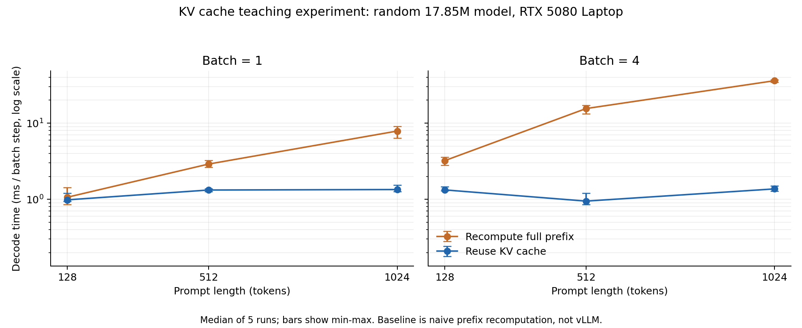

# 今晚小实验：把 KV Cache 的收益和代价跑出来

这是一个已在本机 GPU 跑通的教学实验。用同一个随机初始化的小型 decoder-only Transformer，对比两种计算方式：

1. **无 KV Cache**：每处理一个新 token，把整个历史前缀重新计算一遍。
2. **有 KV Cache**：先计算 prompt，把每层的 K/V 留在预分配显存里；之后每次只计算一个新 token，并让它访问历史 K/V。

目的：理解“为什么缓存能省计算、为什么又占显存、怎么确认优化没有算错”。**不是训练模型、不是可用的文本生成器，也不是对 vLLM/SGLang 的优化。**

## 已完成的结果

2026-10-20，本机 NVIDIA GeForce RTX 5080 Laptop GPU，16 GB 显存；Python 3.12.9；PyTorch `2.8.0.dev20250505+cu128`；CUDA runtime 12.8。

- 4 层、512 隐藏维、8 个 attention heads、词表 4096，共 **17,853,440 个参数**。
- 全部 float32，关闭 TF32；没有量化、混合精度、torch.compile 或 CUDA Graph。
- 每个配置先检查 prefill 及 32 个增量位置的 logits，再各预热 2 次，正式测量各 5 次；两种路径交错测量、轮换先后顺序，以下取中位数。
- 输入是固定的随机 token 序列，两种路径权重和输入相同；没有采样，以免生成不同 token 导致不公平对比。

| Batch | Prompt tokens | 无缓存 ms/步 | 有缓存 ms/步 | 无缓存时间 / 有缓存时间 | KV 容量 MiB |
|---:|---:|---:|---:|---:|---:|
| 1 | 128 | 1.063 | 0.982 | 1.08× | 2.5 |
| 1 | 512 | 2.902 | 1.323 | 2.19× | 8.5 |
| 1 | 1024 | 7.872 | 1.342 | 5.87× | 16.5 |
| 4 | 128 | 3.213 | 1.328 | 2.42× | 10.0 |
| 4 | 512 | 15.537 | 0.946 | 16.43× | 34.0 |
| 4 | 1024 | 36.089 | 1.369 | 26.37× | 66.0 |

**所有配置的逐位置 logits 均通过 `rtol=1e-4, atol=1e-5` 的 allclose，最大绝对误差约 `1.07e-6`。** 测量中 PyTorch 的峰值 allocated 显存最大约 264.3 MiB；这不包含 CUDA context、其他进程及 PyTorch 之外的显存占用。

谨慎解读：

- 这些倍数只相对“每步重算完整前缀”的朴素基线。成熟推理引擎本来就在用 KV Cache，不能说“我把 vLLM 加速了 26 倍”。
- B=1、prompt=128 的两条路径测量范围明显重叠：无缓存约 0.856–1.436 ms/步，有缓存约 0.945–1.198 ms/步。因此 **1.08× 不能视为可靠的实际提升证据**。
- 缓存路径不同配置之间的小幅快慢变化，可能来自 CPU 提交、GPU 调度、频率和其他系统噪声。本实验没有 profiler 证据，不能确定归因。
- 本机是 Windows 笔记本，小模型的 Python/GPU 启动开销影响较大。没有隔离后台 GPU 负载、锁频或做稳态服务压测。
- 当前结论是“缓存消除了大量重复计算，同时新增持久 K/V 内存”；不推断线上服务的成本收益、p99 延迟或训练后模型质量。

## 怎么运行



PowerShell 中：

```powershell
$env:PYTHONUTF8 = '1'
$env:PYTHONIOENCODING = 'utf-8'
Set-Location -LiteralPath 'C:\Users\ROG\Documents\八股\ecophase_prep_20261020'
& 'E:\my_evns\py312_torch28\python.exe' -m unittest -v test_kv_cache_lab.py
& 'E:\my_evns\py312_torch28\python.exe' .\kv_cache_lab.py
```

不需要装包、不下载权重、不访问外部模型 API。默认会重写同目录的 `results_kv.json` 和 `results_kv.csv`。每轮通常几十秒，受系统负载影响；不用为这个实验熬夜等待。

若想保留首轮结果，后续指定新输出目录：

```powershell
& 'E:\my_evns\py312_torch28\python.exe' .\kv_cache_lab.py --output-dir .\rerun --repeats 7
```

## 先用 30 分钟读懂 5 件事

**1. 一个 token 如何往后算？**

token ID → token embedding + position embedding → 多层 attention/MLP → final norm → 最后一个位置的 logits。logits 是词表中每个候选 token 的未归一化分数。本实验只比较分数一致性，不讨论生成内容。

**2. 为什么旧 K/V 能复用？**

因果 attention 规定每个位置只能看自己及此前位置。关闭 dropout 后，增加未来 token 不会改变过去位置的计算结果，所以过去每一层产生的 K/V 可以保留。新 token 的 Q 与旧 K/new K 算相关性，再加权旧 V/new V，得到新位置的输出。

KV Cache 不等于“不读历史”：每个 decode 步仍需要访问历史 K/V；它省掉的是重算历史 token 的投影、MLP 及其他中间计算。

**3. 为什么不存 Q？**

当前 decode 只需要新位置的输出，因此只需要新位置的 Q；之前位置的 Q 用于之前位置的输出，已经完成任务。历史 K/V 会被未来的 Q 再次访问，因此需要留存。

**4. 两个特别容易算错的地方。**

- **位置偏移**：prompt 长度为 512，接下来 token 的位置是 512，不是重新从 0 开始。看代码 `start_pos` 和 `positions`。
- **因果 mask**：全序列 prefill 要用 causal mask；一次只新增一个 token 时，存下来的全部 K/V 都是合法历史。这里应允许它访问所有已写入位置。直接对 Q 长度 1、K 长度大于 1 的矩阵使用 upper-left causal mask，会错误地遮掉大部分历史。

代码特意只支持“完整 prefill + 单 token decode”。多 token chunk decode 需要按位置构建偏移因果 mask；当前会拒绝这种调用，防止产生看似合理但实际错误的结果。

**5. Cache 有多大？**

一般公式：

`KV 字节数 = 2 × 层数 × batch × 缓存 token 数 × KV heads × head_dim × 每元素字节数`

其中 2 来自 K 和 V。本实验是普通 MHA，`KV heads = attention heads = 8`，因此还可写成：

`2 × 4 × batch × (prompt + 32) × 512 × 4 bytes`

例如 batch=4、prompt=1024：`2 × 4 × 4 × 1056 × 512 × 4 = 69,206,016 bytes = 66 MiB`。

真实模型若用 GQA/MQA，KV heads 少于 query heads，缓存会更小。本实验没有实现它们。

## 计时和显存口径

- **prefill**：一次处理完整 prompt；缓存路径包括把 prompt 的 K/V 写入 cache。
- **decode**：随后处理固定的 32 个新输入 token；每步要得到下一位置的 logits。两种路径都不把 lm_head 应用到所有历史位置。
- **不包含**：分词、网络、请求排队、采样、cache 初次分配、权重加载、数据搬入 GPU。
- **GPU 时间**：CUDA event 包围 prefill/decode 区间，读数前 synchronize。这个区间也可能包含 CPU 无法及时提交工作造成的 GPU 空闲；不是 profiler 汇总的纯 kernel 执行时间。
- `decode_ms_per_step`：32 步 decode 总时间 / 32。一个 batch 步同时处理 B 个 token，因此它不是总 token 吞吐的倒数；该口径更接近此固定 batch 的逐步延迟。
- `prefill_plus_decode_wall_ms`：同步后的端到端本地调用 wall time，仅含上述计算范围；可用来观察 event time 与实际调用耗时的差别。
- `base_allocated_mib`：本轮 cache 分配前，PyTorch 当前存活 tensor 占用。
- `peak_allocated_mib`：本轮从 cache 分配起到 prefill/decode 完毕的 PyTorch 峰值 allocated，包含模型和输入。
- `peak_increment_mib`：上述峰值减本轮基线，不等于 cache 大小，也不是整个进程的额外显存。
- `reserved_after_run_mib`：PyTorch allocator 保留的显存，受先前运行影响，不拿来比较两条路径的独占显存。
- `kv_cache_capacity_mib`：按分配形状计算的 K/V 容量，是持久缓存成本最直观的数值。

原始每轮数据、系统信息和所有正确性误差都保存在 JSON。CSV 是摘要，方便表格软件查看。

## 明天可以怎样讲

> 我以前没有独立做过推理引擎优化，这次为理解岗位，用 PyTorch 做了一个随机权重小模型实验：对比每步重算前缀和预分配 KV Cache 的增量 decode。先验证每一步 logits 一致，再测六个 batch/长度配置。长前缀下缓存明显省计算，但短前缀小 batch 的差异落在噪声里；缓存本身又要占显存。我知道这不是生产引擎收益，下一步想先学会区分具体 workload 的算力、显存带宽、排队与调度瓶颈，再决定优化哪一层。

这段话仅在你亲自看懂代码、能解释测试后使用。代码由 AI 辅助搭建；不应把它表述成过去已独立完成的项目。

可以继续提出一个可检验的问题：

> 如果您的实际客户请求长度、输出长度和并发分布差别很大，我们是否应该以满足 TTFT/ITL 约束的有效吞吐来选配置？我想先从一个可复现的 workload sweep 做起，而不是只看单个 prompt 的最高 tokens/s。现在客户最紧的是首 token 延迟、生成速度还是总成本？

这是合适的工程研究切口，但还不是新颖算法。当前实验没有请求到达过程和排队，不能从这些结果直接回答服务层问题。

## 验证记录与边界

`test_kv_cache_lab.py` 中 3 项 CPU 测试已通过：

1. 多请求、多位置，缓存结果与完整前缀结果逐步一致。
2. cache 未写区初始化成 NaN，复用为更短请求仍不读到无效旧内容。
3. 不支持的多 token chunk decode 明确报错。

GPU 六组配置还各自检查了 prefill + 32 个 decode 位置。有限测试不能证明一切输入都正确；它覆盖了本次实际计时路径的 mask、位置和缓存读写风险。

后续若扩展为分页 KV、滑动窗口、RoPE、GQA、张量并行或连续 batching，需要新增对应实现和验证；本项目目前没有这些能力。
